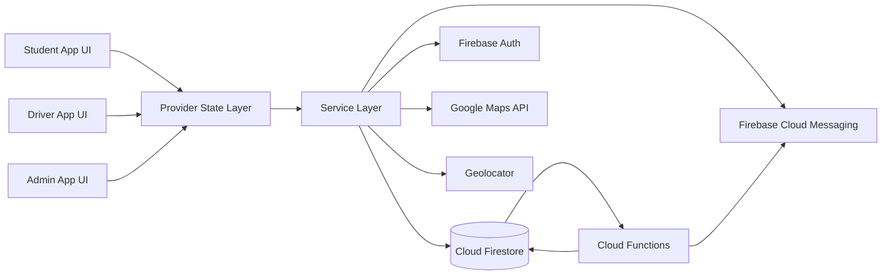

# UNIMAS SmartBus Thesis Defense Outline

## 1. Project Title
UNIMAS SmartBus: A real-time campus bus tracking, notification, and fleet management system for students, drivers, and administrators.

## 2. Short Project Summary
UNIMAS SmartBus is a Flutter mobile application backed by Firebase that lets students track buses in real time, helps drivers update live location and trip status, and gives admins tools to manage buses, routes, schedules, announcements, and reports.

The project is designed to solve common campus transport problems:
- Students do not know where the bus is.
- Drivers need a simple way to share live GPS and occupancy.
- Admins need centralized control over fleet operations.
- The system should notify users when something important happens.

## 3. Problem Statement
The project addresses these issues:
- Bus locations are often unclear or delayed.
- Students may miss buses or wait without knowing whether a bus is approaching.
- Drivers may forget to end a shift or leave a bus active accidentally.
- Admins need real-time visibility and control over buses, routes, and announcements.
- Safety and reliability require automatic checks, not just manual user actions.

## 4. Project Objectives
- Provide real-time bus tracking on a mobile map.
- Let drivers update bus position and occupancy continuously.
- Let admins manage buses, routes, schedules, reports, and announcements.
- Send targeted push notifications for service updates and safety reminders.
- Add safeguard logic to reduce stale trips, stale locations, and repeated notification spam.

## 5. User Roles and Responsibilities
### Student
- View live bus locations.
- Check routes, schedules, stops, occupancy, and ETA-related information.
- Receive announcements and bus-related notifications.
- Submit reports.
- Mark themselves as waiting at a stop.

### Driver
- Start and end shifts.
- Share live GPS location.
- Update bus occupancy.
- Receive shift reminders.
- Continue receiving state updates if the bus is activated remotely.

### Admin
- Manage buses, routes, stops, schedules, and announcements.
- Assign and activate buses.
- Monitor real-time operations.
- Review reports and operational status.

## 6. Technology Stack
### Frontend
- Flutter
- Dart
- Provider for state management
- Google Maps Flutter for map display
- Geolocator for GPS and distance checks
- Hive for local notification preferences
- Flutter Local Notifications for foreground notification display

### Backend and Cloud Services
- Firebase Authentication
- Cloud Firestore for real-time data storage
- Firebase Cloud Messaging for push notifications
- Firebase Cloud Functions for automated notification and safeguard logic

### External APIs and Services
- Google Maps API
- Android and iOS location services
- Firebase push notification infrastructure

## 7. Why These Technologies Were Chosen
### Flutter
- Single codebase for Android and iOS.
- Faster development for a university project.
- Good UI performance for map-based apps.

### Provider
- Simple and readable state management.
- Fits the project structure well.
- Works cleanly with Firestore streams and service classes.

### Firestore
- Real-time updates are critical for live bus tracking.
- Data sync is automatic across students, drivers, and admin screens.
- Better fit than polling for live transport status.

### Firebase Cloud Messaging
- Needed for announcements and safety-related reminders.
- Supports targeted push notifications.

### Cloud Functions
- Used for automated background logic.
- Good for reminders, route notifications, and stale-shift safeguards.
- Keeps critical logic off the client.

### Geolocator
- Needed for driver GPS tracking and student stop detection.
- Supports distance-based checks for waiting detection and auto-cancel behavior.

### Hive
- Stores per-user notification preferences locally.
- Prevents preferences from being mixed between users sharing one device.

## 8. System Architecture
### High-Level Flow

### How the Pieces Relate
- UI screens only handle user interaction and display.
- Providers hold application state and coordinate between UI and services.
- Services contain business logic and direct Firebase or device access.
- Firestore stores bus, route, trip, user, report, and waiting-state data.
- Cloud Functions automate notification delivery and safety actions.

## 9. Frontend Architecture
### Main Frontend Modules
- Authentication screens
- Student map and dashboard
- Driver dashboard and trip controls
- Admin dashboard and management screens
- Shared widgets such as notification sheets, live trip pill, and common dialogs

### Frontend Patterns Used
- StreamBuilder for live Firestore data
- ChangeNotifier for state updates
- Consumer and Provider for UI refresh
- Reusable widgets for common UI sections
- Conditional rendering based on user role

### Frontend Responsibility
The frontend does not own the core transport logic. It:
- Displays live data.
- Accepts user actions.
- Sends actions to service classes.
- Reacts to data changes from Firestore and providers.

## 10. Backend Architecture
### Firestore Collections Used
- `users`
- `buses`
- `routes`
- `bus_stops`
- `schedules`
- `trips`
- `reports`
- `announcements`
- `waiting_students`
- `device_tokens`
- `device_bus_sessions`
- `student_trips`

### Backend Responsibility
The backend handles:
- Real-time state storage.
- Notification fan-out.
- Scheduled reminders.
- Safety checks for stale shifts.
- Remote activation logic.

## 11. Data Flow Examples
### A. Driver Location Update Flow
1. Driver starts a shift.
2. `DriverTrackingService` gets GPS positions every 10 seconds.
3. The bus document in Firestore is updated with latitude, longitude, and `lastUpdated`.
4. Students and admins see live updates through Firestore streams.
5. Cloud Functions use `lastUpdated` to detect stale shifts.

### B. Student Waiting Flow
1. Student opens the map screen.
2. The app checks whether the student is near a bus stop.
3. If the student stays near the same stop for 5 minutes, the app creates a `waiting_students` record.
4. Cloud Functions check whether any active bus is within range.
5. If a bus is close enough, the student receives a push notification.

### C. Admin Announcement Flow
1. Admin creates an announcement.
2. Firestore stores the new announcement.
3. Cloud Function sends push notifications to stored device tokens and the announcements topic.
4. Clients show the message in the notifications sheet.

## 12. Smart Notification System
### What It Does
The app uses smart notifications for transport-related reminders and announcements, such as:
- Bus approaching a stop.
- Tap-out reminder.
- Driver shift reminder.
- Shift started notification when an admin activates a bus.
- General announcements.

### Current Notification Types
These are the notification types currently implemented in the project:

| Type | Trigger | Audience | Automated? |
| --- | --- | --- | --- |
| `announcement` | A new announcement is created or resent by admin | Students, drivers, admins with subscribed devices | Yes |
| `bus_approaching` | A bus is within range of a waiting student | Students who are marked as waiting | Yes |
| `tap_out_reminder` | A student has stayed on a bus for more than 30 minutes | Students with an active bus session | Yes |
| `shift_reminder` | An active bus has had no GPS update for more than 1 hour | Assigned driver | Yes |
| `shift_started` | An admin remotely activates a bus | Assigned driver | Yes |

### Manual vs Automated
- Manual notifications are created by admins through announcements.
- Automated notifications are generated by Cloud Functions based on live Firestore state, location, or time thresholds.
- In-app notification display is handled by the client, but the trigger logic lives in Firebase or the notification services.

### How It Works
- Notification preferences are stored locally in Hive.
- Device FCM tokens are stored in Firestore.
- Cloud Functions fan out notifications to relevant users.
- Foreground messages are shown using local notifications.

## 13. Safeguards and Safety Logic
This is an important thesis-defense topic because the app does not only show data; it also tries to prevent stale or unsafe transport states.

### 13.1 Driver Location Staleness Safeguard
- Driver GPS updates are written every 10 seconds while tracking is active.
- If an active bus has no GPS update for more than 1 hour, the app sends a driver shift reminder.
- If an active bus has no GPS update for more than 15 minutes, Cloud Functions automatically end the stale shift.
- When this hard safeguard triggers, it:
  - sets the bus `isActive` to false,
  - resets occupancy to 0,
  - marks active passenger sessions as completed,
  - marks active student trips as completed,
  - records that the shift was auto-ended by safeguard logic.

### 13.2 Student Waiting Safeguard
- The app detects when a student stays near a bus stop for 5 minutes.
- The student is only auto-marked as waiting if they remain within the stop radius.
- If the student moves too far away from the stop, waiting status is cancelled automatically.
- This prevents stale waiting records from remaining active when the student leaves.

### 13.3 Bus Approaching Notification Safeguard
- Cloud Functions check active buses every 2 minutes.
- If a bus is within 500 meters of a waiting student, the student receives a bus approaching notification.
- To prevent spam, the same waiting student is not notified repeatedly within a short interval.

### 13.4 Tap-Out Reminder Safeguard
- Active student bus sessions are checked every 5 minutes.
- If a student has been on the bus for more than 30 minutes, the app sends a tap-out reminder.
- Reminders are rate-limited so they do not repeat too frequently.

### 13.5 Remote Bus Activation Safeguard
- If an admin activates a bus remotely, the assigned driver receives a shift-start notification.
- If the driver app is already open, the provider logic keeps the shift state synchronized with Firestore.

### 13.6 Notification Spam Protection
- Bus approaching notifications are rate-limited.
- Tap-out reminders are rate-limited.
- Shift reminders are rate-limited.
- This keeps the app useful instead of noisy.

## 14. What the App Notifies Users About
### Students
- Bus approaching their waiting stop.
- Tap-out reminder after a long trip.
- General announcements.

### Drivers
- Shift start when the bus is activated by an admin.
- Shift-end reminder if the bus has been active without a GPS update for over an hour.
- Route or service notifications depending on the configuration.

### Admins
- The admin interface mainly manages operations rather than receiving student-style smart notifications.

## 15. Justification of the Design
### Why Real-Time Streams Were Used
- Bus tracking loses value if updates are delayed.
- Firestore streams let all roles see the same current state quickly.

### Why Notifications Are Split Between Client and Cloud Functions
- Client handles preference storage and token registration.
- Cloud Functions handle automated delivery and background checks.
- This separation is more reliable and easier to defend architecturally.

### Why Stale-Shift Auto-End Exists
- A bus marked active but not updating location is a reliability risk.
- Auto-ending the shift prevents the system from showing outdated active buses.
- It also cleans up sessions and trips so the database stays consistent.

### Why Waiting Detection Exists
- Students often wait without manually pressing a button.
- Auto-detection reduces friction and improves notification accuracy.

## 16. Limitations You Can Acknowledge in Defense
- The system depends on GPS and internet connectivity.
- Map and notification reliability can be affected by device permissions.
- Some safeguards depend on scheduled Cloud Functions, so timing is periodic rather than instant.
- Real-world performance depends on device battery, background restrictions, and Firebase connectivity.

## 17. Future Work
- More precise ETA prediction.
- Better offline handling.
- Smarter route congestion detection.
- Push notification personalization.
- Driver fatigue or long-shift warnings.
- Map performance optimization for low-end devices.

## 18. Likely Defense Questions
- Why did you choose Flutter instead of native Android/iOS?
- Why use Firestore streams instead of polling?
- How do you ensure notification relevance and avoid spam?
- What happens if the driver stops sending GPS updates?
- How does the system know when a student is waiting?
- How do you prevent stale bus data from staying active?
- Why is Cloud Functions needed if the app already has Flutter logic?

## 19. Short Answer Notes for Key Questions
### If asked: What happens when the driver location is inactive?
- The system first sends a shift reminder after 1 hour without GPS updates.
- If the bus stays stale for more than 15 minutes, Cloud Functions auto-end the shift.

### If asked: What happens when a student is waiting at a bus stop?
- The app can auto-detect waiting after 5 minutes near a stop.
- Once a bus is close enough, the student gets an approaching-bus notification.
- If the student moves away, the waiting state can be cancelled automatically.

### If asked: Does the app notify users?
- Yes. It sends announcements, approaching-bus alerts, tap-out reminders, shift reminders, and shift-start alerts.

## 20. Closing Statement
UNIMAS SmartBus combines real-time tracking, state management, push notifications, and automated safety checks into a single campus transport system. The strongest technical points in defense are the live Firestore architecture, the role-based frontend, and the safeguard logic that prevents stale bus states and noisy notifications.
